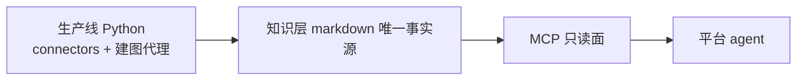
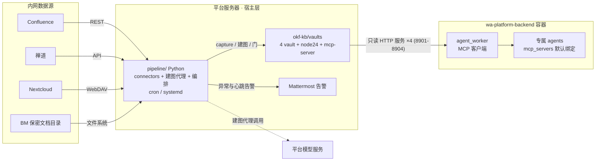
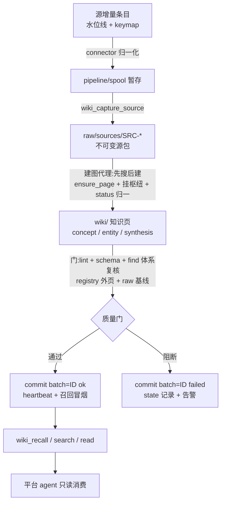

# Architecture Spine — okf-kb 知识库系统

## Design Paradigm

**三段知识管道 over 一源两读者内核。**

- **管道(跨进程)**:抽取(connector 归一化 → 暂存)→ 建图(生产线建图代理驱动 LLM 建知识页)→ 发布(只读 MCP 面)。
- **内核(vault 内,okf-kb 既有范式)**:markdown 是唯一事实源;写侧 pi-llm-wiki 管生命周期与词法检索,只读结构层 iwe 管体系树/图查询/OKF 校验(iwe 仅用于建库侧)。

**相对 2026-09-24 封版指南的取舍(有意,非疏漏):**

- 建图者从"有纪律的人工/LLM 会话"改为**生产线建图代理**:实测 `wiki_ingest` 内置自动路径的子代理无工具、无纪律提示词(不挂枢纽/不查重/每页单链接/status 写 `ingested`),不可作为全自动链路的建图者。
- 消费面不提供 iwe `retrieve`(避免双 MCP 面;代价与回退见 Deferred)。
- 根 `index.md` 的人工追加不可持续:每次写操作被工具**全量重写**(实测 `buildDirectoryIndexes`,无合并)。体系可枚举性由 `iwe find` 查询承担,门**不以 tree 可达性为判据**(实测:根 index 追加独占行链接可让 tree 贯通,但会被重写抹掉)。
- 体系挂载的持久形态不变:枢纽页内独占行链接(inclusion)+ 成员页行内回链(指南 §2)。

层映射:

| 层 | 落点 | 职责 |
|---|---|---|
| 生产线层(宿主,cron/systemd) | `okf-kb/pipeline/` | 抽取、建图代理、质量门、git、心跳 |
| 知识层(vault 目录) | `okf-kb/vaults/<source>/.llm-wiki/` | raw(不可变)+ wiki(知识页)+ meta(生成物) |
| 消费层(okf-kb 服务器常驻 + 平台注册) | 只读 HTTP 服务 × 4 + 平台 mcp_server_configs × 4 | 只读检索(recall / search / read / status / lint) |

依赖方向(单向,反向禁止):



## Invariants & Rules

### AD-1 — 一源一库:库 = 源 = vault;隔离等级 = 依赖层逻辑隔离 [ADOPTED]

- **Binds:** 抽取 / 编译 / 发布 / 消费,全部
- **Prevents:** 保密内容混入共享库;单源重建牵动他源;绑定粒度粗于业务边界
- **Rule:** 每个数据源恰有一个 vault 与一个 MCP server 实例(共 4 套);库间不共享页面文件(**读写双向**:写侧不混入,读侧不合并——含个人库禁令,见 AD-3/AD-8);跨源知识关联由"同一 agent 同时绑定多库"实现;跨库不设统一体系枢纽页(代价:无跨库体系视图,接受)。
- **授权边界语义(实测修正):** 平台**无 MCP 库级授权**——任意登录用户可经会话参数 `mcps` 直接挂载任意 active server,agent 绑定只是默认值、不是访问控制(chat.py:1018)。**BM 库对平台全员可见、可查为已接受风险**;隔离强度 = 独立 vault + 独立 server + 独立配置的**依赖层逻辑隔离**,不含文件级/用户级强制。

### AD-2 — markdown 唯一事实源,写入只经 pi-llm-wiki 工具

- **Binds:** 生产线(抽取/建图/治理),运维全流程
- **Prevents:** 绕过事件溯源导致 registry 无记录、search/recall 不可见;手改 raw 使重跑失真
- **Rule:** 知识页创建/更新只经 `wiki_ensure_page` / `wiki_ingest`(自动路径经 `commit_synthesis` 同入 registry);`raw/` 只增不改(唯一例外:BM 库误捕经审批改写历史,见 AD-10);`meta/` 与 `wiki/**/index.md`、`wiki/log.md` 是生成物,禁止手编;每个 SRC 源包保留原料出处(源系统 key 随包落盘,见 AD-6)。流水线全部写入只经 MCP 工具调用(代码评审红线——guard 钩子仅覆盖交互会话,对 Python 流水线无效;违规后果不可逆,`reindex` 救不回),由批末"registry 外页面"检查兜底(AD-7)。

### AD-3 — 消费面只读:bundle 只读补丁,落地前禁注册 [ADOPTED]

- **Binds:** 平台集成 / MCP 暴露面
- **Prevents:** 消费 agent 误用写侧工具破坏图谱一致性;补丁未落地/丢失时的静默失效
- **Rule:** 平台侧 4 条 server 指向的服务以只读模式启动:**bundle 只读补丁**按环境变量(`LLM_WIKI_READ_ONLY=1`)只注册 `wiki_recall` / `wiki_search` / `wiki_read` / `wiki_status` 四个纯读工具(**修订②定案**:裁除 `wiki_lint`,白名单 5→4;以 4 工具版补丁落地 + smoke 断言恰为 4 为平台注册前提——现状补丁仍 5)。补丁与 `wiki_read` 构成**补丁序列**,记 CHANGELOG,smoke 守护(`REQUIRED_TOOLS` 补 `wiki_read` + 只读模式断言工具集恰 4 个)。**补丁落地并 smoke 验证前,禁止在平台注册 4 条 server**(当前 bundle 注册 16 工具,含 11 个写侧/运维侧)。
- 只读补丁**只管注册裁剪**(2026-10-14 对照 bundle 代码核实:白名单外工具物理不注册,无其他职责)。**个人库合并不归补丁管**:对照实验证明只读模式下宿主 `~/.llm-wiki` 内容照样混入 recall 结果;**唯一防线 = env `WIKI_HOME` 与 `WIKI_ROOT` 同置**(stdio 与 HTTP 两形态都是),见 AD-8。
- **只读面的已知例外:`wiki_lint` 带写入能力**(2026-10-14 实测):默认调用即写 `outputs/lint-<日期>.md` 与 `.discoveries/gaps.json`;`auto_fix=true` 追加写 `meta/` 元数据与 `wiki/log.md`,并可创建 **stub 页**(`status: stub`);参数对消费面完整暴露。不改已有页内容,但"建 stub 页"是实质写入——**修订②定案:平台消费面裁除 `wiki_lint`(纯读),运维所需 lint 走 okf-kb 侧本机管理通道;该收窄待落地(现状 5 个)**。另:`wiki_recall` 返回 `path` 为服务端绝对路径(未裁剪)。
- 消费面返回形状(`recallLinksThreshold` 等)是该库**受版本控制**的配置,变更需记录;标准消费流:recall 定位 → `wiki_read` 读全文(长页自动分页)。

### AD-4 — 生产线与平台解耦(业务接口唯一)

- **Binds:** 部署 / 运维
- **Prevents:** 平台变更或故障波及建库;建库负载挤占平台资源;凭据边界交叉
- **Rule:** 抽取/建图/校验/git 全部由 okf-kb 侧独立进程承担(宿主 cron/systemd;不选平台 APScheduler——其作业体与进程边界都在 backend 容器内,复用即违背解耦)。**业务数据接口唯一** = MCP 读通道(HTTP 常驻只读服务;vault 文件不出 okf-kb 服务器,平台侧零副本);平台周边设施为**显式复用项**(Tika 文档解析、Mattermost 告警、模型服务),各自凭据独立落点与独立配置,禁止把平台凭据写入 okf-kb 侧的任何 MCP/服务配置(AD-10)。
- **残余耦合面(显式):** `tools/` 由常驻只读服务进程加载,升级/打补丁需重启服务,是**在线变更**——必须窗口化并保留回滚目录(AD-11)。

### AD-5 — 编译模型供给:跟随平台配置,vault settings 单点声明 [ADOPTED]

- **Binds:** 建图代理 / (未来)嵌入
- **Prevents:** 外网模型依赖;模型配置分散不可审计;key 落 git;无模型时静默降级
- **Rule:** 每个 vault 的 `.pi/settings.json` 是该 vault 全部 llm-wiki 运行参数的**唯一来源**,至少显式声明:`taskModel`(**对象** `{provider, id}`——字符串形态被静默忽略)、`taskModelBaseUrl`、`taskModelApiKeyEnv`(**禁止字面 key**)、`synthesisLanguage: "zh"`、`wikilinkValidation: "strict"`、`synthesisMaxTokens`、`recallLinksThreshold`;未列键视为初始化缺陷。
- 端点与模型**跟随平台**:部署期与平台 backend 的 `VLLM_BASE_URL`/`VLLM_MODEL` 对齐(OpenAI 兼容;内网部署即内网模型服务;live 配置存在外网端点与内网 vLLM 并存的漂移,以部署期实测为准,见 Open Questions)。
- 建图代理/工具 spawn 一律以 **vault 根为 cwd + 显式 `WIKI_ROOT`**;禁止依赖 `~/.pi/agent` 全局设置(启动断言 HOME 下无 llm-wiki 命名空间配置)。
- **模型不可用 = 批次失败**:`wiki_ingest` 未配模型时静默降级为"返回原料供调用方自行综合"——流水线断言不落入该路径;失败不推进水位线(幂等重试)。建库负载**限流**(全局并发上限 1–2;夜间低峰调度),不与平台交互业务抢容量。

### AD-6 — 增量 = 水位线 + 内容指纹 + keymap + 周期对账

- **Binds:** 抽取
- **Prevents:** 重复捕获(SRC 泛滥/页面抖动);漏捕(知识陈旧);删除/改名无传播(永不消失的陈旧页)
- **Rule:** 每源水位线(Confluence `lastModified` / 禅道时间戳 / WebDAV `OC-ETag`(去 `-gzip` 后缀)/ 文件 mtime)+ 内容 hash 幂等。**源系统 key 随包落盘**:每次 capture 后把 `{source_key, src_id, content_hash, captured_at}` 追加 `pipeline/state/<source>.json` 的 keymap(与水位线同受保护,AD-11)。同一 key 重捕:hash 未变**跳过**;hash 变化 → 新建 SRC,新 source 页记 `supersedes: <旧SRC>`,旧页置 `deprecated`。
- **BM 特款(修订③)**:BM 无系统版本标记——码 = **原件字节 sha256(非提取文本)**;遍历白名单目录取 `路径/大小/mtime`,mtime+大小有异则读原件流式算哈希裁决(哈希相同仅更账本、不建包);判定在解封会话内执行,候选清单人审在内容处理之前;账本随封存回密文态(AD-11)。明细见概要设计 §4.2。
- **删除/改名 = 周期性全量对账**(按源扫描存在性,产出 `deleted[]`/`moved[]`;水位线仅为优化,**不是唯一发现机制**——Confluence CQL 有索引延迟且对移动/归档不可靠、删除无墓碑)。对账结果落 state + 告警人工确认;**一期不自动删页**(删除是业务信号,误删不可逆;人工确认后置 `deprecated`)。
- **顺序契约**:capture 全部成功(源包与 manifest 完整)→ 水位线推进 → 建图;禁止先推水位线。
- **全量语义**:忽略水位线重扫源以检测漏捕/删除,**不重捕**内容未变条目;真正的按源重建 = 新 vault + 重绑定(运维流程),不在同一 vault 内执行。

### AD-7 — 每批质量门 + 失败隔离 + 批次契约

- **Binds:** 建图 / 治理 / 告警
- **Prevents:** 脏数据静默进库;批次身份歧义(门/告警/commit 对不上);失败批次归属不明;门与告警各造判定
- **Rule:**
  - **批次** = 一次编排器运行,identity = `<source>-<UTC 起始时间戳>-<序号>`,由编排器生成,写入 state 与本批所有产物(lint 报告、校验输出、commit message、告警)。
  - 门清单**单一来源** `pipeline/config/gate.yaml`(阻断/告警分级;门与告警共读,禁止各自硬编码)。**实现基座(修订②)**:以既有 okf-tidy 脚本组为基座(`gate.sh` = `iwe schema validate` + `vault-health --gate`),其余门项在其上扩展,不出现两套。阻断级至少含:
    1. `wiki_lint`:断链/孤儿清零;歧义/矛盾/gaps 分类处置(不得丢弃);
    2. `iwe schema validate`(okf / okf-log;okf-index 已按初始化契约收窄);
    3. **体系复核**:`iwe find --filter '$includedBy: {match: {type: synthesis}}'`(本批新页必须被某 synthesis 枢纽约束;以 `find` 为准,**不以 tree 可达性为判据**);
    4. **registry 外页面**:磁盘 `.md` 不在 registry = 绕过工具写入的证据;
    5. **status 归一**:本批 source 页 status ∈ {draft, stable, deprecated};`skeleton`/`ingested` 由建图代理批内归一,仍违例 = 该批异常。okf.yaml **不得放宽**;
    6. **raw 不可变**:与批次前基线快照比对(不用裸 `git diff`——首批发无基线);
    7. `wiki_status`:blockingDiagnostics 空 + `okf-0.2` 声明在;
    8. **提取质量(修订②)**:源包 `extraction_status` 非 success(failed/unsupported)= 阻断候补、人工处置;提取文本长度比异常进告警。
  - **人审**:每批 synthesis 页抽样清单随批次报告归档(语义错误只在 synthesis 层人审——指南 §7 的中心论断;告警通道送达)。
  - **失败隔离**:失败批次仍 commit(message 前缀 `batch=<ID> status=failed`,**只 add 本批路径清单,禁止 `git add -A`**);`failed_batches[]`(批次 ID/失败项/页面清单/时间)落 state;已建页面保留待修;raw 不可变保证可重跑;单源失败不阻断他源;失败批次**不推进水位线**。
  - **告警**:Mattermost 启用为部署验收项(含一次真实演练);未启用时降级 = 非零退出码 + state 记录(不得静默)。

### AD-8 — 平台接入 = HTTP 常驻只读服务(url 注册 + 只读与 WIKI_HOME 服务端配死)

> **2026-10-14 修订**:接入形式由 stdio(容器内 spawn + 挂载)改为 **HTTP**——okf-kb 服务器常驻只读服务,平台按 url 注册。修订依据与全文见概要设计 §6.2、同目录 `平台侧改动-HTTP接入片段.md`;旧版「容器路径 + 挂载面」条款作废。

- **Binds:** 集成 / 部署
- **Prevents:** 库文件进平台侧(挂载面放大隔离半径);服务端 env 漏配(WIKI_ROOT 丢失/个人库内容混入);未认证监听面暴露全库;消费面误开写工具
- **Rule:** okf-kb 服务器每库一个**只读 HTTP 常驻服务**(`LLM_WIKI_HTTP=1` + `LLM_WIKI_READ_ONLY=1`;systemd 常驻),平台后台 `mcp_server_configs` 配 4 条 url 型 server:
  - **url** = `http://<okf-kb 服务器>:89xx/mcp`(8901-8904 逐库);transport=http;command/args/env 不填;headers 供认证反代用;
  - **服务端 env 配死**:`WIKI_ROOT` 与 `WIKI_HOME` **同路径、必须都配**——`WIKI_HOME` 是关闭 recall 个人库合并的**唯一防线**(2026-10-14 对照实验:只读补丁不管合并,不设时宿主 `~/.llm-wiki` 内容混入结果发给消费方);
  - **访问控制(取代旧「挂载面即权限面」)**:HTTP 无内置认证,监听放开前须防火墙收敛到平台侧或前置认证反代;
  - **跨仓交付项**:wa-platform 仅后台注册 4 条 server 记录 + agent 绑定(平台代码零改动;无需 compose 挂载、无需容器变更);
  - **验收**:okf-kb 侧 4 服务 active 且端口可达;后台 4 条 server active;每 server 起会话 `wiki_status` 成功返回本库;工具列表恰为 4(纯读白名单,修订②裁除 `wiki_lint`;依赖 AD-3 4 工具版补丁);宿主 `~/.llm-wiki` 内容不出现在任何库结果;平台 **timeout 显式配置**(DB 默认 120 不生效,实际回落 300s);
  - agent 绑定 = **默认绑,非授权边界**(AD-1);平台静默降级面(名字写错/未 active/服务未起 = 无工具或连接失败)由验收兜住。

### AD-9 — 一库一写者(排他写权)

- **Binds:** 编排器 / 人工建库会话
- **Prevents:** 双写者并发——工具层 SRC 编号为非原子读改写(nextSourceId 无锁),同号会**静默覆写**不可变源包,provenance 指向错源且 lint 查不出
- **Rule:** 任一 vault 任一时刻只允许一个写侧进程。任何写侧序列(capture / 建图 / lint / 手工会话)必须先原子获取 `<vault>/.llm-wiki/meta/writer.lock`(mkdir 语义);锁含 `{pid, 批次 ID, 获取时间, 来源: pipeline|session}`;获取失败即退出非零并告警,**禁止重试绕过**。人工会话 = 先停 timer、再显式取锁;流水线遇 session 锁 → 跳过本批(state 记 `skipped_locked`,不算失败、不推水位线)。**单一调度器串行四源**(或 `flock -n` 防 cron 重叠);僵尸锁超 24h 由流水线回收并告警。

### AD-10 — 凭据与容器可见面(含 BM 风险接受条款)

- **Binds:** 部署 / 平台集成 / 生产线 / 安全
- **Prevents:** 凭据三向暴露(容器 / 每会话 config.yaml / git 历史);接入面放大隔离半径;保密原件扩散
- **Rule:**
  1. **凭据落点白名单**:`pipeline/config/.env`(0600,宿主)+ vault settings 的 `taskModelApiKeyEnv` 引用为唯一落点。**禁止面**:禁止进 vault git、禁止进 MCP `env` 块或平台 MCP 配置(stdio 时代 env 块会被 `yaml.dump` 复制到每用户每次会话的 config.yaml,同文件还含平台 `VLLM_API_KEY`/`DATABASE_URL`;HTTP 形态平台侧不填 env,禁止面不变)、禁止进 `raw/`、禁止进告警与日志;模型用**专用低权 key**(与平台交互 key 分离)。
  2. **每 vault 仓 `.gitignore`** ≥ `meta/qmd/`(二进制生成物,可重建)与含 key 文件;BM 仓禁远端。
  3. **宿主权限**:BM vault 独立 uid/组 0750,禁 world-readable。
  4. **BM 风险接受条款 [ADOPTED]**:BM 库对平台任何登录用户可见、可查(平台无库级授权,实测会话参数直挂);已接受(设计层面)。配套硬约束:**BM 原件不入 vault**(raw 只存提取文本 + 来源引用:系统/路径/hash;原件留源存储);BM 抽取范围**白名单** + 每批新增文件清单人审(**候选清单产自判定链,人审在内容处理之前**——判定链见 AD-6 BM 特款,修订③);BM 不接无人值守自动线,批次人工触发(生产写路径见概要设计 §7.1,修订②);误捕处置 = 经审批对 BM 仓做 history rewrite(AD-2"raw 只增不改"的**唯一例外**)。
  5. **内容边界(内外有别)**:**Mattermost 告警消息**(外发)= 批次 ID + 源 + 门 code + 计数,禁文档标题/路径/正文;BM 告警收件人限定。**本地运行日志**(宿主内)为排障保留完整明细(含文档 key/路径),敏感性由文件权限承担(`logs/` 与 BM vault 同域 0750)。

### AD-11 — 可观测、恢复与升级(运维 envelope)

- **Binds:** 运维全流程
- **Prevents:** 流水线静默停摆;静默空库;单边恢复(全量重捕或永久漏捕);在线升级事故
- **Rule:**
  1. **可观测三件套,同挂批次 ID**:(a) **完整运行日志**——connector/建图代理/门/git 各阶段明细按批次归档 `logs/<source>/`,可完整复盘一次运行(排障与审计);(b) **结构化批次报告**——批次 ID/源/起止/水位线推进/捕获数/建图页数/门结果与 code 清单/索引状态/raw·wiki·meta·logs 体积/耗时,落 `pipeline/state/`;(c) **心跳**——`logs/heartbeat.json`。日志轮转保留 ≥90 天。**心跳与陈旧度告警(修订②:检测与通知与既有巡检 `kb-patrol` 合并为一条告警通道,不建两套)**:心跳超阈值、或某源超 SLA 无成功批次 → 告警(区分"流水线没跑"与"没新数据");宿主磁盘 80% 告警。
  2. **召回冒烟**:批末对本批新页标题 recall 一次,期望非空——bundle 检索读不到 registry 时**静默返回空结果**,"库空"与"库坏"必须可区分(这是唯一探针);平台侧 `mcp-stderr.log` 与 `get_mcp_status` 纳入巡检。
  3. **备份恢复域 = vault(含 `meta/events.jsonl`,事件溯源权威)+ `pipeline/state/`(水位线/keymap)+ `pipeline/config/`(凭据,决定能否恢复运行)**,三者同域。**BM 例外(修订③)**:BM 的 state 明细(账本/候选清单/批报告)随封存回密文包,恢复域含 `.gpg` 单包——备份 BM 库 = 备份该单包。vault 可重建 state(keymap 可对账重算),state 不可重建 vault;单边恢复 = 全量重捕或永久漏捕。恢复步骤:clone vault 仓 → 恢复配置 → 缺 registry 时 `wiki_rebuild_meta` → 起 server → 消费冒烟。RPO ≤ 1 批、RTO ≤ 2h(部署期确认);恢复演练(修订②):P3 做一次完整演练起步,此后按运维成熟度定周期(不预先承诺"每季度")。
  4. **升级流程**:版本记录(源 commit + 补丁清单 + 校验和);升级 = 离线包替换 + **补丁重放** + smoke(16 工具 + 只读模式恰 4,修订②)+ 复检(`wiki_status`;`wiki_lint` 走本机管理通道,修订②,需要时 `wiki_rebuild_meta`);窗口 = 无消费会话、无批次运行;**回滚 = 保留上一版 `tools/` 整目录**;vault 兼容:`okf_version` / registry `version` / qmd `STORE_VERSION` 入升级 checklist;跨版本勿原地升 qmd,`wiki_reindex` 用 changed / 显式 lexical 组件(内网**禁** `scope:"all"`——会拉 node-llama-cpp)。

## Consistency Conventions

| Concern | Convention |
|---|---|
| 命名:MCP server | `okf-wiki-<source>`;平台注册工具名经 sanitize(`-`→`_`):**`mcp__okf_wiki_<source>__<tool>`**;toolset 名 `mcp-okf-wiki-<source>`(保留连字符) |
| 命名:vault / 页面 | `vaults/<source>/`,内为 `.llm-wiki/{raw,wiki,meta}`;页面目录复数:concepts / entities / analyses / requirements / syntheses / sources;SRC 包内:manifest.json / extracted.md / attachments / original(BM 库无 original) |
| 数据:时间 / 水位线 | ISO 8601 带时区;水位线 `pipeline/state/<source>.json`(工具 manifest 的 `captured` 为 UTC 日期无时间——批次时间以编排器记录为准) |
| 数据:文档 key | 源系统稳定 ID(Confluence pageId / 禅道数字 ID / 网盘相对路径 / BM 路径——hash 仅作"码"、不入 key,修订③);抽取产物 `<key>.md`;keymap 落 state(AD-6;BM 账本随密文,AD-11) |
| 数据:归一化 | 统一 markdown + frontmatter(源系统/URL/版本/时间);Office/PDF **必须**上游经 Tika 归一(bundle 自带 markitdown 路径内网不可用) |
| 状态:批次 ID | `<source>-<UTC 起始时间戳>-<序号>`(AD-7) |
| 状态:告警 | 批次 ID + 源 + 门 code + 计数;禁标题/路径/正文;Mattermost = bot token 直调 REST(DM 形态);启用为部署验收项 |
| 状态:日志 | 三层同挂批次 ID:完整运行日志 `logs/<source>/`(全部运行明细,排障与审计用)+ 结构化批次报告(`state/`)+ 心跳 `logs/heartbeat.json`;保留 ≥90 天(含轮转);vs 平台 30 天两套口径注明 |
| 状态:git | 每 vault 独立仓;提交范围 = `wiki/ + raw/ + meta/(除 qmd/)+ .iwe/ + settings(无 key)`;**禁止 `git add -A`**(用批次路径清单);message 带 `batch=<ID>`;okf-kb 仓 `.gitignore` 含 `vaults/ pipeline/state/ logs/ raw-inbox/*` |
| 配置:vault 初始化契约 | `wiki_bootstrap` → `iwe init --okf`(仅空库执行一次,重跑 = 变更需确认)→ **收窄 `[schemas.okf-index]` 绑定**(必做:llm-wiki 自动维护的 index 形态与 OKF §8 天然冲突)→ 确认根 `okf_version: "0.2"` → settings.json(AD-5 键)→ git init |
| 配置:凭据 | 见 AD-10(白名单 + 禁止面 + 权限) |
| 检索:reindex | 内网**禁** `scope:"all"`;只用 changed / 显式 lexical 组件;recall/search 读 registry(qmd 非消费链路);消费侧不改索引 |
| 检索:消费流 | recall 定位 → `wiki_read` 读全文;`recallLinksThreshold` 按库 pin |
| 质量:页约束 | iwe schema `maxTokens` 限页大小;**okf.yaml 不得放宽**;status 归一职责在建图代理(AD-7) |
| 禁用清单 | `wiki_watch`(全自动场景误用)、`wiki_reindex_embeddings`(内网)、iwe `normalize`(迁移期除外,先 `--dry-run`)/ `extract` / `inline` / `squash` |
| 安全:文件权限 | vault 0750(BM 独立组);`pipeline/config/.env` 0600;`logs/` 0750(含完整运行明细,与 BM 风险面同域) |
| 运维:并发 | 见 AD-9(单写者 + 单一调度器串行四源) |
| 运维:进料口 | 人工进料口 `raw-inbox/`(指南模块 0 语义保留);机器暂存 `pipeline/spool/<source>/`——**两者不得混用** |

## Stack

| Name | Version |
|---|---|
| Node(okf-kb 自带离线) | 24.21.0 |
| pi-llm-wiki bundle | git main f0b6959 自建 + **补丁序列**(`wiki_read` / 只读 `LLM_WIKI_READ_ONLY` / `LLM_WIKI_HTTP` / flags 生命周期标注 / lint 明细化,全录 CHANGELOG);package.json 自述 `0.6.3` 为本仓本地版本号,非上游版本 |
| iwe(仅建库侧) | 0.24.2(linux-x64,离线) |
| Python(流水线,宿主) | ≥3.11 专用 venv,vendored 离线 wheels(requests / lxml / pyyaml / mcp 客户端);**不依赖平台容器环境** |
| LLM(建图) | 平台模型服务(部署期与平台 `VLLM_BASE_URL`/`VLLM_MODEL` 对齐;OpenAI 兼容;权重与 id 名的漂移以平台配置为准) |
| 文档解析 | Apache Tika(复用平台服务端点,pipeline 侧独立配置) |
| 调度 | cron / systemd timer(宿主;理由见 AD-4) |
| 版本管理 | git(每 vault 独立仓库) |
| 告警 | Mattermost(bot token 直调 REST API;启用为部署验收项) |

## Structural Seed

### 部署视图



### 数据流(单批)



### 目录结构(新增部分)

```text
okf-kb/
  tools/                # 既有:node24 + pi-llm-wiki(补丁序列)+ iwe;升级走补丁重放
  raw-inbox/            # 既有:人工进料口(指南模块 0;与 pipeline/spool 不得混用)
  pipeline/             # 新增:抽取/建图/编排(Python,宿主 venv)
    connectors/         #   confluence.py / zentao.py / nextcloud.py / bm.py
    agent/              #   建图代理(LLM 循环 + 纪律提示词,由 SKILL.md 派生)
    orchestrator/       #   批次编排:capture→建图→门→commit + writer.lock + 心跳
    config/             #   gate.yaml / 各源范围 / 凭据 .env(0600,不进容器)
    state/              #   水位线 + keymap + failed_batches + run report
    spool/              #   机器暂存(connector 产物,进 capture 前)
  vaults/               # 新增:4 个知识库(BM 仓禁远端;BM 原件不入 raw)
    confluence/  zentao/  nextcloud/  bm/
      .llm-wiki/{raw,wiki,meta}
      .iwe/             #   校验配置(随仓提交)
      .pi/settings.json #   AD-5 键(无字面 key)
  logs/                 # 新增:完整运行日志(按批次)+ heartbeat.json(≥90 天,含轮转)
```

## Capability → Architecture Map

| Capability / Area | Lives in | Governed by |
|---|---|---|
| 数据抽取(四源 → 归一 → 源包) | `pipeline/connectors` + `spool` + `wiki_capture_source` | AD-6(增量/对账/keymap)、AD-9(单写者)、AD-10(BM 原件与白名单)、归一化约定 |
| 管理更新(增量/全量/知识编译/知识更新) | `pipeline/orchestrator` + `agent`,每 vault | AD-2(唯一写径)、AD-5(模型供给)、AD-6(全量语义)、AD-7(门/失败隔离)、AD-11(心跳/恢复) |
| 查询应用(平台只读消费) | okf-kb 只读 HTTP 服务 × 4 + 平台 `mcp_server_configs` × 4 + 专属 agent | AD-1(库边界/风险接受)、AD-3(只读补丁)、AD-8(接入契约)、AD-10(凭据面) |

## Deferred

- **根 index.md 体系区段守护**(可选可视性补强):门用 `find` 不依赖 tree;若人工巡检需要 tree 全貌,批末守护脚本幂等追加区段(实测追加独占行链接后 tree 贯通)。
- **消费侧体系语境注入(iwe retrieve)**暂不做;若弱模型缺体系上下文而误用知识,回到本项。
- **检索升级(embedding 语义召回)**:平台 bge-m3 可复用;启用时 `wiki_reindex` 必须显式 components(禁 all);先词法 BM25 上线,按召回效果决定。
- **平台 UI 演进**(知识库多选绑定、库状态展示;注:现"知识库"开关硬编码 `kag-mcp` 为空壳,勿当前例)。
- **各源抽取范围配置**(Confluence space 清单 / 禅道项目与类型 / 网盘目录清单 / BM 白名单),实施配置项。
- **体系树种子**:首版体系树 = 源系统分类树按指南 §5 翻译法生成(原目录树 → 枢纽页,原父子关系 → 独占行挂载链接)。
- **备份远端与快照策略**(恢复域已钉,见 AD-11;远端形态实施期定)。
- **建图代理提示词资产**(`pipeline/agent/prompts`,由 SKILL.md + 指南 §2/§3 派生),实施内容。

## Open Questions

- Confluence 是 Cloud 还是 Server/DC(决定 v2 API 可用性)与认证方式;CQL 索引延迟常数。
- 禅道 API 版本(开源版 ≥16.5 REST v1;token 请求头为 `Token`;内置页面接口只认 session,与 REST token 不通用)。
- Nextcloud WebDAV 细节(优先 `OC-ETag`;注意 `-gzip` 后缀陷阱与 `Depth: infinity` 限制)。
- BM 共享目录范围与文件格式清单(待盘点;与容量预算合并)。
- 平台模型端点实况(live `.env` 当前指向外网 deepseek-v4-flash,与内网 vLLM 形态并存;部署期实测 OpenAI 兼容性与中文长文能力后对齐)。
- 平台模型服务是否支持多 key/配额(决定建库专用低权 key 与限流方案)。
- okf-kb HTTP 服务宿主部署路径与端口分配(建议 8901-8904;部署期定)。
- 四源服务账号凭据来源与轮换方式。
