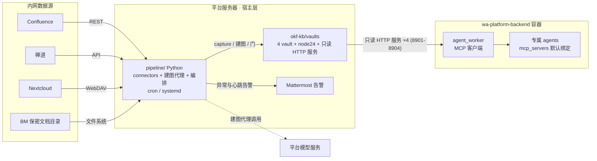
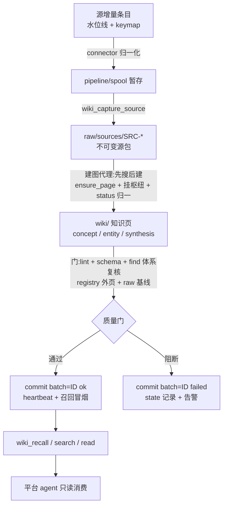

# okf-kb 知识库系统概要设计

## 1. 文档说明

本文面向团队评审,说明如何基于 okf-kb 工具链,为 wa-platform 智能体平台构建四个 wiki 知识库(MCP 形式),覆盖**数据抽取、管理更新、查询应用**三大模块。

| 文档 | 定位 | 读者 |
|---|---|---|
| 本文 | 设计说明:背景、方案、取舍、实施路径 | 评审团队、需求方 |
| `ARCHITECTURE-SPINE.md`(同目录) | 构建契约:11 条 AD + 一致性约定 + 结构种子 | 实施者 |

本文引用 `AD-n` 编号处,含义以 spine 为准;AD 索引见附录 A。**状态:初稿,待团队评审。**

> **2026-10-14 修订②(评审讨论)**:本轮五组改动——①新增 §1.1 组件导读(bundle 等名词解释,**初读者先看**);②§4.2 拆出"提取层"设计(内容形态矩阵 + LLM 归一 + 质量信号 + 可重做);③§6.1 平台消费面定案 4 个纯读工具;④§7.1 补 BM 生产写路径(人工触发 + 内存盘,不接自动线);⑤§8.2/§9 基线分期、告警合并、演练后置。文内修订处均标"(修订②)"。

> **2026-10-15 修订③(BM 判定链)**:BM 是四源中唯一没有系统版本标记的源(其余三源的"码"均由源系统自记:Confluence 版本号 / 禅道编辑时间 / 网盘 ETag;BM 只有裸文件系统的 mtime),其"码"必须自算。本轮改动:①§4.1 BM 行明确哈希口径(原件字节 sha256,非提取文本),并补 Confluence 版本号实例实测结论;②§4.2 新增"BM 判定链"块(两步判定 + 改名人审兜底 + 预筛即少读 + 账本随密文);③§4.3 加各源"码"口径交叉引用;④§7.1 批流程补"判定与候选清单人审"次序;⑤§8.3 恢复域补 BM 例外。配套 ARCHITECTURE-SPINE 同步:AD-6 BM 特款、AD-10 人审时序、AD-11 恢复域、数据约定 BM key 定义。

**术语速查**:

| 术语 | 含义 |
|---|---|
| vault | 一个知识库的完整目录(=`okf-kb/vaults/<source>/`),内含 `.llm-wiki/{raw,wiki,meta}` |
| SRC | 一次"源包"捕获,`raw/sources/SRC-xxx/` 内为不可变原料副本 + manifest |
| 建图 | 把原料编译为知识页(concept/entity/synthesis)并把页面挂进体系树的过程 |
| 枢纽页 | synthesis 页:体系的目录节点,`includedBy` 关系指向它的成员页 |
| 水位线 | 每源增量游标(`pipeline/state/<source>.json`),推进即"已处理到此" |
| keymap | 源系统 key → SRC 编号的映射表(与水位线同落 state) |
| state | `pipeline/state/` 下的运行状态文件集(水位线/keymap/failed_batches/批次报告) |
| 门 | 批次提交前的自动质量校验(阻断/告警两级,清单在 `pipeline/config/gate.yaml`) |
| OKF | okf-kb 的知识格式规范(okf-0.2),含 schema 校验与体系树工具(iwe) |
| recall | 消费面主检索工具(`wiki_recall`),按主题召回相关页 |
| 批次报告 | 每批结构化运行报告(run report),落 `pipeline/state/` |
| 冒烟 | 自动化健康探针:工具集冒烟(接口面)、召回冒烟(检索面) |
| bundle | pi-llm-wiki 的**单文件打包产物**;本仓对它的修改均以补丁形式(见 §1.1) |
| 补丁序列 | 打在 bundle 上的全部本仓修改(记 CHANGELOG);升级上游时须重放(§8.4) |
| MCP | "模型-工具"调用协议;平台 agent 与建库代理均经 MCP 使用工具(见 §1.1) |

### 1.1 组件导读(初读此项目者先看)

本设计建立在几个既有组件与外部设施上;它们分别是什么、和本设计什么关系,一次讲清:

| 组件 | 是什么 | 与本设计的关系 |
|---|---|---|
| **MCP** | "模型-工具"调用协议:智能体(agent)通过 MCP server 使用外部工具;平台上的 agent 可绑定若干 server | 知识库以 MCP server 形式对平台暴露(消费面);生产线的建图代理也以 MCP 调用工具 |
| **pi-llm-wiki** | 本仓的**写侧建库工具集**(Node 程序):封存原料(capture)、建页、治理检查(lint)、词法检索 | 本设计全部写入只经它的工具(AD-2);消费面检索同源 |
| **bundle(打包件)** | pi-llm-wiki 上游源码**打包成的单个文件**(`tools/pi-llm-wiki/mcp-server.mjs`,约 11MB/24 万行,全部依赖打进去),不提供模块扩展点 | 本仓对它的任何修改只能以"补丁"直接打在打包件上(只读模式、HTTP 模式、检索标注、lint 明细均为补丁);升级 = 换文件 + 重放全部补丁 + 复检(§8.4) |
| **iwe** | 只读**结构层**工具:体系树、图查询、OKF 格式校验 | 仅建库侧使用(质量门/复核);不进消费面 |
| **okf-tidy** | 体检脚本组:`vault-health`(未整理/塌平/替代一致性检查)+ `gate.sh`(批次门禁)+ `install-hooks`(编辑留痕) | 质量门的现成基座(§5.4),在其上扩展 |
| **secret-vault** | 保密库零明文工作流:内存盘(tmpfs)工作区 + gpg 密文包,用时解封、用完封存 | BM 库的存储形态;生产写路径见 §7.1 |
| **node24** | 随仓携带的 Node 24 运行时(离线部署用) | 工具链与巡检脚本的运行基础 |
| **kb-patrol.sh** | 定时巡检脚本:git 拉料、体检、lint、日报与通知 | 运维巡检;流水线心跳/陈旧度告警与之合并(§8.2) |

平台周边设施(显式复用,凭据独立):**Tika**(文档解析服务,Office/PDF → 文本)、**Mattermost**(告警通道)、**平台模型服务**(建图与归一所使用的 LLM)。

## 2. 背景与目标

### 2.1 需求

团队知识分散在四个源:Confluence wiki 博文、禅道(项目/bug/需求)、Nextcloud 网盘、BM 保密网络安全知识文档。目标:把这些知识编译为独立知识库,以 **MCP 形式**接入平台,绑定特定 agent,供用户问答检索。数据更新模式为混合:部分源持续增量(禅道/网盘),部分源以存量为主。各源文档量级与容量预算属实施前盘点项(见 §10 Q4/Q7)。

### 2.2 现状与可复用资产

- **okf-kb(本仓)**:已封版(2026-09-24)的"一源两读者"工具链——markdown 唯一事实源;写侧 pi-llm-wiki(生命周期 + BM25 词法检索,内网离线);只读结构层 iwe 0.24.2(体系树/图查询/OKF 校验)。自带 Node 24 与全部依赖,为离线部署包。另有既有脚本/工具组:okf-tidy(体检与门禁)、secret-vault(保密库零明文)、kb-patrol(巡检)——见 §1.1。
- **wa-platform**:backend(FastAPI)支持 stdio/HTTP 两种 MCP server(管理后台 `mcp_server_configs` 可配 url 型,本项目的接入走 HTTP),agent 可绑定 server;周边设施完备(模型服务、Tika 文档解析、Mattermost 告警、docker 沙箱)。

### 2.3 设计目标与明确非目标

| 目标 | 非目标(明确不做) |
|---|---|
| 四源抽取全自动、增量为主、可周期全量对账 | 物理隔离/文件级强权限(BM 走逻辑隔离) |
| 知识编译走 OKF 规范,体系可枚举、可校验 | 消费面向量语义检索(先 BM25 词法;向量检索列为暂缓项,见 §10) |
| 每批自动质量门 + 失败隔离 + 告警 + 人审 | 平台 UI 改造(平台代码零改动,仅后台配置) |
| 消费面只读,平台 agent 开箱可用 | 跨库统一知识图谱(跨源关联靠同一 agent 同时绑定多库) |

## 3. 总体架构

**范式:三段知识管道 over 一源两读者内核。** 管道(跨进程)= 抽取 → 建图 → 发布(对应下文模块:抽取 = §4,建图 = §5 管理更新,发布 = §6 查询应用);内核(vault 内)= okf-kb 封版范式,不改动其规则,只在两处升级:①建图者由"人工/LLM 会话"改为**生产线建图代理**(见 §5.3);②消费面收窄为**只读 4 个工具**(修订②,见 §6.1)。

**库边界:一源一库(AD-1)。** 每个源一个 vault、一条 MCP server(共 4 套),互不共享页面文件;同一 agent 可同时绑定多库实现跨源问答。

### 3.1 部署视图



要点:**生产线全部在宿主层**(okf-kb 侧独立进程),与平台解耦(AD-4);平台智能体只经**只读 HTTP 接口**访问各库(库文件不出 okf-kb 服务器),不经手任何写路径。

### 3.2 数据流(单批)



### 3.3 仓库目录(新增部分)

```text
okf-kb/
  tools/         # 既有:node24 + pi-llm-wiki(补丁序列)+ iwe
  raw-inbox/     # 既有:人工进料口(与机器暂存 spool 不得混用)
  pipeline/      # 新增:抽取/建图/编排(Python,宿主 venv)
    connectors/  #   confluence / zentao / nextcloud / bm 四源连接器
    agent/       #   建图代理(LLM 循环 + 纪律提示词)
    orchestrator/#   批次编排:capture→建图→门→commit + writer.lock + 心跳
    config/      #   gate.yaml / 各源范围 / 凭据 .env(0600,不进容器)
    state/       #   水位线 + keymap + failed_batches + 批次报告
    spool/       #   机器暂存(connector 产物,进 capture 前)
  vaults/        # 新增:4 个知识库(BM 仓不配置 git 远端;BM 原件不入 raw)
    confluence/ zentao/ nextcloud/ bm/
      .llm-wiki/{raw,wiki,meta}  .iwe/  .pi/settings.json
  logs/          # 新增:流水线日志 + heartbeat.json(≥90 天,含轮转)
```

## 4. 数据抽取(模块一)

### 4.1 四源接入总表

| 源 | 协议 | 认证 | 增量信号 | 内容指纹 |
|---|---|---|---|---|
| Confluence | REST(v2/CQL;版本待确认) | 服务账号(PAT/Basic 待确认) | `lastModified` | pageId + version |
| 禅道 | REST v1(开源版 ≥16.5) | `Token` 请求头 | `lastEditedDate` 时间戳 | id + 时间戳 |
| Nextcloud | WebDAV(PROPFIND) | 应用密码 | `OC-ETag`(需去 `-gzip` 后缀) | 相对路径 + ETag |
| BM | 共享目录(网盘)中的文件 | 文件系统权限 | mtime | 路径 + **原件字节内容 hash(sha256,非提取文本)**——自算码,判定链见 §4.2(修订③) |

四源接口细节(版本、认证形态)列入实施前验证清单,见 §10。**Confluence 版本号已实例实测确认(2026-10-15)**:`/rest/api/content/<pageId>?expand=version` 返回 `version.number` 与 `when`,随保存连续递增——"零下载取码"路径成立(修订③)。

### 4.2 抽取流程与源包落盘

**获取分两层(修订②)**:**访问层**——连接器按水位线拉取增量条目(枚举/认证/分页/幂等,**固定代码**,不涉内容理解);**提取层**——把内容转成忠实 markdown。分开设计的原因:源会增多,而内容形态只有一撮;"提不准"的风险全部集中在提取层,不能一句"归一化"带过(源信息照旧写入 frontmatter:系统/URL/版本/时间)。

**提取层:按内容形态分工**(形态决定策略;新源接入只做映射,不重写解析代码):

| 内容形态 | 典型来源 | 策略 |
|---|---|---|
| 纯文本 / markdown | 网盘 .md/.txt | 直通,零转换风险 |
| 结构化字段 | 禅道 bug/需求;Confluence 优先取 storage/ADF 结构化正文 | 直读字段拼装——能拿结构化的,不解析渲染后的 HTML |
| HTML 正文 | wiki 博文、禅道富文本 | 正文抽取(readability 式)打底 + **LLM 清洗**(去导航/宏/评论噪音,保留表格与结构) |
| Office / PDF | 网盘、BM | Tika(平台已有)打底 + **LLM 重排结构**(表格塌平是 Tika 典型短板) |
| 图片 / 扫描件 | 网盘、BM | OCR 为独立能力;依 Q4 格式盘点决定是否立项 |

**LLM 归一是一等步骤**:与建图共用同一模型通道(AD-5 口径不变:专用低权 key、限流、模型不可用 = 批次失败)。管线形态:`拉取(代码) → 归一(LLM,复杂格式才走) → spool → capture`;成本为每文档一次性。capture 工具自带提取路径薄弱(markitdown 依赖内网不可用),**归一必须在 capture 上游完成**,capture 只做封存。

**质量信号与兜底**:
- capture 产物 `manifest.json` 原生记录 `extractor` / `extraction_status`(success/failed/unsupported)/ `content_type`——质量门直接消费(§5.4 增补项 8);另设"提取文本长度比异常(过短)"告警;
- 抽检:HTML/Office/PDF 每类首批各抽几份与原件比对,并入既有批次抽检,不新增机制;
- **可重做**:非 BM 库的源包**原生保留原件**(`SRC-*/original/`,文件类与 URL 类捕获自动落盘)——换更强模型可重归一,不必回源;重归一 = 新 SRC + supersedes 链(§4.3 机制)。BM 不存原件、提取质量一次性(见下),故 LLM 归一必做。

连接器产物暂存 `pipeline/spool/<source>/` → 经 MCP `wiki_capture_source` 落入 `raw/sources/SRC-*/`(`manifest.json` + `extracted.md` + `original`(非 BM)+ `attachments`)。

**raw 不可变**:源包只增不改,保证任意批次可重跑、来源可追溯可审计(AD-2)。`pipeline/spool/` 是机器暂存,`raw-inbox/` 保留为人工进料口,两者不得混用。

**BM 特别规定(AD-10)**:①原件(Word/PDF 本体)**不存进 vault**,raw 只存提取文本 + 来源引用(系统/路径/hash),原件留在源存储;②抽取范围走白名单,每批新增文件清单人工审;③生产写路径见 §7.1(BM 不接无人值守自动线)。

**BM 判定链(修订③)**:BM 无系统版本标记,"码"为自算——遍历白名单目录取 `路径/大小/mtime`:路径不在账本 → 「新增」候选;大小或 mtime 与账本不同 → 读原件**流式算 sha256** 裁决(哈希相同 → 仅更新账本 mtime/大小,文件"动过但没变",不建包;哈希不同 → 「变更」);两者均相同 → 跳过(不读文件)。要点:①**哈希口径 = 原件字节,非提取文本**(提取文本受归一模型/提示词版本影响,拿它当源指纹会把"重归一"误判为"源变了";原件始终留在源存储,账本可随时重扫源重建);②**预筛即少读**——大小+mtime 一致的文件不读内容,涉密文件的读取面压缩到"仅疑似变更";③**改名的兜底是人审**——路径为键,改名会被认成新文件,但候选清单本就人工审,确认为改名后**账本改键、不重新收包**(周期对账 `moved[]` 见 §4.4);④**时序与存放**——判定在解封会话内执行、人审在内容处理之前(§7.1),账本与候选清单随封存回密文态(不落普通磁盘:路径名本身即敏感,口径同 §7.1)。

### 4.3 增量:水位线 + 内容 hash + keymap(AD-6)

每次 capture 后,把 `{source_key, src_id, content_hash, captured_at}` 追加到 `pipeline/state/<source>.json` 的 keymap 中(各源"码"口径见 §4.1 内容指纹列;BM 自算码与判定链见 §4.2,修订③)。同一 key 重捕:hash 未变**跳过**;hash 变化 → 新建 SRC,新 source 页记 `supersedes: <旧SRC>`,旧页置 `deprecated`。

顺序契约:**capture 全部成功 → 水位线推进 → 建图**;禁止先推水位线(否则中断即漏数据)。失败批次不推进水位线,幂等重试。

### 4.4 删除与改名:周期对账(AD-6)

水位线只为优化,不是唯一发现机制(Confluence CQL 有索引延迟、对移动/归档不可靠、删除无墓碑)。因此按源**周期性全量对账**:扫描源侧存在性,产出 `deleted[]`/`moved[]` 落 state 并告警;一期**不自动删页**,人工确认后置 `deprecated`(删除是业务信号,误删不可逆)。

### 4.5 单写者保证(AD-9)

工具层的 SRC 编号是非原子读改写,双写者并发会**静默覆写**源包且 lint 查不出。因此:任一 vault 任一时刻只允许一个写侧进程——任何写侧序列先原子获取 `<vault>/.llm-wiki/meta/writer.lock`;获取失败即非零退出并告警,禁止重试绕过;人工会话先停 timer 再取锁;流水线遇锁记 `skipped_locked` 跳过。**单一调度器串行四源**。

## 5. 管理更新(模块二)

### 5.1 批次契约(AD-7)

**批次** = 一次编排器运行,ID = `<source>-<UTC 起始时间戳>-<序号>`,由编排器生成,并写入 state 与本批全部产物(报告/commit message/告警)。**批次可追溯**是失败隔离、人审抽样、运维排查的共同前提。**触发方式(修订②)**:调度(cron/systemd)自动触发为主,另保留**人工触发单批**(异常重跑、BM 场景,见 §7.1)——同一套批流程与批次 ID,不另立机制。

**失败隔离**:失败批次仍 commit(只 add 本批路径清单,禁止 `git add -A`),`failed_batches[]` 落 state;已建页面保留待修;raw 不可变保证可重跑;单源失败不阻断他源。

### 5.2 知识编译(OKF):vault 结构与页面模型

每个 vault 内:`.llm-wiki/raw/`(源包)+ `.llm-wiki/wiki/`(知识页,唯一事实源)+ `.llm-wiki/meta/`(registry 等生成物)。页面目录(目录名均取复数):concepts/entities/analyses/requirements/syntheses/sources。体系挂载形态:枢纽页内**独占行链接**(inclusion)挂成员,成员页行内回链。

**首版体系树** = 各源目录/分类树按建库指南 §5 翻译法生成(原分类节点 → 枢纽页,原父子关系 → 独占行挂载链接);此后由建图代理增量维护,并经门 3 复核(§5.4)。根 `index.md` 相关延后项见 §10。

**初始化契约**(每库一次):`wiki_bootstrap` → `iwe init --okf`(仅空库执行)→ **收窄 `[schemas.okf-index]` 绑定**(必做——llm-wiki 自动维护的 index 形态与 OKF 规范固有冲突)→ 确认根 `okf_version: "0.2"` → 写 `.pi/settings.json` → git init。

### 5.3 建图代理:本设计的核心取舍

**为什么不用 `wiki_ingest` 内置自动路径**:评审实测证实,其内部子代理无工具、系统提示词只有"忠实摘要"(无建图纪律)——不挂枢纽、按 slug 精确去重(概念分叉)、每页仅 1 条链接、status 写 `ingested`(不在 `okf.yaml` 枚举内)。产出**通不过质量门**,不能作为全自动链路的建图者。

**改用生产线建图代理**(AD-5 供给模型;已确认):

1. 编排器(Python)取本批源包,驱动 LLM 循环调用 MCP 工具;
2. 每份原料:**先搜后建**——`wiki_search` 查重与查既有页 → `wiki_ensure_page` 建/更页面(type 选择、挂枢纽、双向链接纪律);
3. 批内统一 **status 归一**(`skeleton`/`ingested` → 合法枚举);
4. 纪律提示词资产(`pipeline/agent/prompts`)由 `SKILL.md` + 建库指南 §2/§3 派生;
5. **模型不可用 = 批次失败**,不落静默降级路径。

### 5.4 质量门(AD-7)

门清单单一来源 `pipeline/config/gate.yaml`(阻断/告警两级;门与告警共读,禁止各自硬编码)。**实现基座(修订②)**:门的落地以既有 okf-tidy 脚本组为基座(`gate.sh` = `iwe schema validate` + `vault-health --gate`,已覆盖门 2 与"未整理/塌平"检查),其余门项在其上扩展——设计与脚本不出现两套。阻断级:

| # | 门(工具/检查) | 判据 |
|---|---|---|
| 1 | `wiki_lint` | 断链/孤儿清零;歧义/矛盾/gaps 分类处置(不得丢弃) |
| 2 | `iwe schema validate` | okf/okf-log 通过(okf-index 已收窄) |
| 3 | 体系复核 | `iwe find --filter '$includedBy: {match: {type: synthesis}}'`:本批新页必须被某枢纽约束 |
| 4 | registry 外页面 | 磁盘 `.md` 不在 registry = 绕过工具写入的证据 |
| 5 | status 归一 | 本批 source 页 status ∈ {draft, stable, deprecated} |
| 6 | raw 不可变 | 与批次前基线快照比对(不用裸 `git diff`) |
| 7 | `wiki_status` | `blockingDiagnostics` 空 + okf-0.2 声明在 |
| 8 | 提取质量(修订②) | 源包 `extraction_status` 非 success(failed/unsupported)阻断候补、人工处置;提取文本长度比异常进告警 |

门 3 以 `find` 为准、不以 tree 可达性为判据:根/目录 `index.md` 由工具全量重写(实测),人工追加体系区段不可持续(见附录 B)。

**人审聚焦点**:语义错误只在 synthesis 层人审(指南 §7 的中心论断)——每批抽样清单随批次报告(run report)归档。**抽样频率(修订②)**:前 3–5 批逐批抽,稳定后按周期合并抽(标准不降,频率随运维成熟度调整)。**告警**:Mattermost 启用为部署验收项(含真实演练);未启用时降级为非零退出码 + state 记录,不得静默。

### 5.5 知识更新与全量语义(速查)

| 变化 | 处置 |
|---|---|
| 上游内容修改 | 版本替换机制见 §4.3(hash 变化 → 新 SRC + `supersedes` 链,旧页 `deprecated`) |
| 上游删除/改名/移动 | 对账与人工确认流程见 §4.4(确认后置 `deprecated`,一期不物理删) |
| 体系调整 | 改枢纽页挂载链接(建图代理动作),经门 3 复核 |

- **全量 = 重扫不重捕**:忽略水位线重扫源;内容未变条目不重捕。
- **按源重建 = 新 vault + 重绑定**:整库重建不在同一 vault 内执行(属运维流程)。

### 5.6 编译模型供给(AD-5)

每 vault `.pi/settings.json` 是运行参数唯一来源,必设:`taskModel`(**对象** `{provider, id}`)、`taskModelBaseUrl`、`taskModelApiKeyEnv`(**禁字面 key**)、`synthesisLanguage: "zh"`、`wikilinkValidation: "strict"`、`synthesisMaxTokens`、`recallLinksThreshold`。

**端点跟随平台**:部署期与平台 `VLLM_BASE_URL`/`VLLM_MODEL` 对齐(内网部署即内网模型服务)。建图负载**限流**(并发上限 1–2)+ 夜间低峰调度,不与平台交互业务争用容量。禁止依赖 `~/.pi/agent` 全局设置。

## 6. 查询应用(模块三)

### 6.1 只读 MCP 面(AD-3)

**bundle 只读补丁**:以环境变量 `LLM_WIKI_READ_ONLY=1` 启动时按白名单注册工具(写侧工具物理不注册;2026-10-14 对照 bundle 代码核实:补丁只做注册裁剪,不涉其他)。**平台消费面白名单定案 4 个(修订②)**:`wiki_recall`/`wiki_search`/`wiki_read`(读全文,长页自动分页)/`wiki_status`——纯读,无任何写行为的工具。补丁与既有 `wiki_read` 补丁构成**补丁序列**(记 CHANGELOG),配套**工具集冒烟**守护(断言工具集恰为 4 个)。

**`wiki_lint` 裁除的依据(修订②)**:实测其带写入能力(2026-10-14 于只读服务)——①默认调用即写库内 2 个文件(`outputs/lint-<日期>.md` 报告与 `.discoveries/gaps.json`);②`auto_fix=true` 时追加写 `meta/` 元数据(registry/events/index/log)与 `wiki/log.md`,并在"缺失页被 ≥2 页引用"时**创建 stub 知识页**(`status: stub`);③该参数对消费面完整暴露。消费 agent 问答不需要 lint——**裁除,消费面纯读**;运维巡检所需 lint 改走 okf-kb 侧本机管理通道(localhost 管理服务或直调脚本;`scripts/kb-patrol.sh` 随此改造)。**连带改动(待落地)**:补丁白名单 5→4、冒烟断言 5→4、`平台侧改动-HTTP接入片段.md` 与《项目介绍》同步。另:`wiki_recall` 返回的 `path` 是服务端绝对路径(未裁剪)。

**个人库合并不归补丁管**:2026-10-14 对照实验——只读模式下宿主 `~/.llm-wiki` 的内容照样混入 recall 结果;**唯一防线是 env `WIKI_HOME` 与 `WIKI_ROOT` 同置**(服务端配死,见 §6.2)。

> **硬约束:补丁落地并冒烟验证前,禁止在平台注册 4 条 server**(2026-10-14:补丁已落地并实测,本约束处于"已满足"状态;若补丁丢失须回退注册。修订②改白名单为 4 个后,**以 4 工具版补丁落地 + 冒烟断言恰为 4 为注册前提**——现状 bundle 补丁仍是 5 个)——bundle 裸注册即含 16 个工具(11 个写侧/运维侧),会把写能力暴露给消费 agent。

标准消费流:**recall 定位 → `wiki_read` 读全文**。消费面返回形状(如 `recallLinksThreshold`)是该库受版本控制的配置,变更需记录。明确不提供 iwe `retrieve`(避免双 MCP 面;取舍与代价见附录 B)。消费面健康探针(召回冒烟)与平台侧巡检定义见 §8.2。

### 6.2 平台接入配置(AD-8)

> **2026-10-14 修订**:接入形式由 stdio(容器内 spawn 子进程 + 挂载库目录)改为 **HTTP**(okf-kb 侧只读常驻服务 + 平台后台注册 url 型 server)。本节已按新形式重写;贴即用片段见同目录 `平台侧改动-HTTP接入片段.md`,查询链路与保密库开停见 `平台查询流程-HTTP形式.md`。

okf-kb 侧:每库一个只读 HTTP 常驻服务(systemd;`WIKI_ROOT` 与 `WIKI_HOME` **同路径、必须都配**——关闭 recall 的个人库合并,2026-10-14 对照实验实测:不设时宿主 `~/.llm-wiki` 的内容会混入结果返回;只读补丁不管此合并,env 是唯一防线)。平台后台 `mcp_server_configs` 配 4 条 url 型 server:

| 配置项 | 值 |
|---|---|
| name | `okf-wiki-<source>`(工具对 agent 呈现为 `mcp__okf_wiki_<source>__<tool>`,连字符被 sanitize 为下划线) |
| transport / url | `http` / `http://<okf-kb 服务器>:89xx/mcp`(8901-8904 逐库) |
| command / args / env | 不填(HTTP 形式不需要;stdio env 白名单事项随之作废) |
| headers | 直连不填;前置认证反代时填 `Authorization` |
| 挂载 | **无**——库文件不出 okf-kb 服务器,平台侧零 vault 副本;旧「挂载面即权限面」约束随之消失 |
| timeout | **显式配置** |

注 1:timeout 必须显式配置,DB 默认值 120s 不生效、实际回落为 300s(沿旧实测)。
注 2:HTTP 无内置认证,监听放开到内网前须防火墙收敛到消费方或认证反代(见接入片段 §5)。

**跨仓交付项**:wa-platform 后台注册 4 条 server 记录 + agent 绑定(平台代码零改动;无需 compose 挂载、无需 recreate 容器);**贴即用片段与验证步骤见同目录 `平台侧改动-HTTP接入片段.md`(可直接转发平台团队)**。

**验收**:okf-kb 侧 4 服务 active 且端口可达;后台 4 条 server active;每 server 起会话 `wiki_status` 成功返回本库;工具列表恰为 4(白名单:wiki_recall/wiki_search/wiki_read/wiki_status;修订②已裁除 wiki_lint,见 §6.1);宿主 `~/.llm-wiki` 的内容不出现在任何库的检索结果;**每库专属 agent 已建立并默认绑定对应 server**(绑定=默认入口,隔离语义见 §6.3)。

### 6.3 agent 绑定与授权现状(AD-1)

**实测结论:平台无 MCP 库级授权。** 任意登录用户可经会话参数直接挂载任意 active server(chat.py:1018),agent 绑定只是默认值、不是访问控制;`/api/mcps/active` 亦无鉴权。因此**绑定专属 agent 只决定默认可用性,不构成隔离**。BM 库的应对见 §7.1。

## 7. 安全与合规

### 7.1 隔离等级与 BM 风险接受条款(AD-1/AD-10)

**隔离等级 = 依赖层逻辑隔离**:独立 vault + 独立 server + 独立配置;不含文件级/用户级强制。平台全员可经会话参数挂载 BM server,**此为已接受的风险**。

配套硬约束:BM 原件不入 vault;抽取白名单 + 每批新增文件清单人审;宿主侧 BM vault 独立 uid/组 0750、禁 world-readable;BM 仓不配置 git 远端;误捕处置 = 经审批对 BM 仓做 history rewrite(AD-2"raw 只增不改"的唯一例外)。

**生产写路径与封存循环的衔接(修订②)**:BM **不接无人值守自动线**——批次由人工触发,运行形态:人工解封(secret-vault unseal 到内存盘)→ 在 tmpfs 工作区内执行完整批流程(判定与候选清单人审 → 抽取/归一 → capture → 建图 → 门 → commit,判定链见 §4.2 修订③)→ 人工封存(seal)。要点:①解封口令不进入任何自动化(不落脚本/环境变量/定时任务);②BM 的 spool、运行日志与 state 明细均落在解封工作区内、随封存回到密文态——**磁盘不出现任何明文(含日志)**;§7.3"本地日志留完整明细"的通行约定对 BM 不适用,BM 告警仍只含批次 ID + 门 code + 计数;③细则(口令持有流程、批次频率、与白名单人审的合并操作)列 Q8。

### 7.2 凭据边界(AD-10)

| 允许落点 | 禁止面 |
|---|---|
| `pipeline/config/.env`(0600,宿主);settings 的 `taskModelApiKeyEnv` 引用 | vault git;MCP `env` 块(会被复制进每用户每会话 config.yaml,同文件含平台 `VLLM_API_KEY`/`DATABASE_URL`);`raw/`;告警与日志 |

模型用**专用低权 key**(与平台交互 key 分离)。

### 7.3 内容边界

**内外有别**:外发 Mattermost 告警消息只含批次 ID + 源 + 门 code + 计数,禁文档标题/路径/正文;BM 告警收件人限定。**本地运行日志**为排障保留完整明细(含文档 key/路径),敏感性由文件权限承担(`logs/` 与 BM vault 同域 0750)。

## 8. 部署与运维

### 8.1 部署形态(AD-4)

- 生产线(抽取/建图/门/git)= okf-kb 侧独立进程,**宿主 cron/systemd**(不用平台 APScheduler——其作业体在 backend 容器内,复用即违背解耦);
- 与 wa-platform **同机**部署;
- 平台周边设施显式复用:Tika 文档解析、Mattermost 告警、模型服务(各自凭据独立落点);
- **残余耦合面**:`tools/` 是宿主与容器共享 bind mount,升级是在线变更——必须窗口化(窗口定义见 §8.4)。

### 8.2 可观测性与消费健康(AD-11)

- 每批**完整运行日志**:connector/建图代理/门/git 各阶段明细,按批次归档 `logs/<source>/`,可完整复盘一次运行(排障与审计);
- 每批**批次报告**(批次 ID/源/水位线推进/捕获与建图计数/门结果/索引状态/体积/耗时)落 `pipeline/state/`;
- 批末写 `logs/heartbeat.json`;**心跳/陈旧度告警**区分"流水线没跑"与"没新数据";磁盘 80% 告警;**修订②**:心跳文件仍由流水线写,检测与通知与既有巡检(`kb-patrol.sh` 模式)**合并为一条告警通道**,不建两套;
- **召回冒烟**:每批末用本批新页标题 recall,期望非空——bundle 检索读不到 registry 时静默返回空结果,"库空"与"库坏"必须可区分(唯一探针);
- **召回基线评测(黄金问题集)**:每库 20–50 题(直问/同义改写/跨页综合三类配比),测 recall top-5 含期望页的命中率;**达标线 = 总体 ≥80%**(起步值,跑 2–4 周后按分布校准);改写子集命中率单列,作为向量评估的触发读数;P2 起随全量对账节奏周期复跑(监测召回漂移)。**修订②(分期)**:P0 只做 5–10 题/库的**冒烟级基线**(验证链路通);完整黄金问题集(20–50 题)与 ≥80% 达标线后置——等真实用户问题积累 2–4 周后再建更真实;其触发对象(向量评估)本已延后,不复占 P0 出口。
- 平台侧 `mcp-stderr.log` 与 `get_mcp_status` 纳入巡检;
- 日志保留 ≥90 天含轮转(与平台 30 天两套口径,注明);`logs/` 权限 0750。

### 8.3 备份恢复(AD-11)

**恢复域 = vault(含 `meta/events.jsonl`,事件溯源权威)+ `pipeline/state/`(水位线/keymap)+ `pipeline/config/`(凭据)**,三者同域。**BM 例外(修订③)**:BM 的 state 明细(账本/候选清单/批报告)随封存回密文包、不在明文 `pipeline/state/`;BM 的恢复域落在**密文包整体**(`.gpg` 单包)——备份/恢复 BM 库 = 备份/恢复该单包。vault 可重建 state,state 不可重建 vault;单边恢复 = 全量重捕或永久漏捕。恢复步骤:clone vault 仓 → 恢复配置 → 缺 registry 时 `wiki_rebuild_meta` → 起 server → 召回冒烟。**RPO ≤1 批、RTO ≤2h**(部署期确认);**恢复演练(修订②)**:P3 做一次完整演练起步,此后按运维成熟度定周期(不预先承诺"每季度")。

### 8.4 升级与回滚(AD-11)

版本记录(源 commit + 补丁清单 + 校验和);升级 = 离线包替换 + **补丁重放** + **工具集冒烟**(16 个工具 + 只读模式恰为 4 个,修订②)+ 复检(`wiki_status`;`wiki_lint` 走本机管理通道,修订②)。窗口 = 无消费会话、无批次运行;**回滚 = 保留上一版 `tools/` 整目录**。vault 兼容项(`okf_version`、registry 版本、qmd 的 STORE_VERSION)列入升级检查清单;`wiki_reindex` 内网**禁** `scope:"all"`,只用 changed/显式 lexical 组件。

## 9. 实施路线

| 阶段 | 内容 | 出口标准 |
|---|---|---|
| P0 单源骨架 | 一个源(建议 Confluence)打通:初始化契约 → connector(含提取层,§4.2 修订②) → capture → 建图代理 → 门 → commit;平台侧完成只读补丁(消费面 4 工具,§6.1 修订②)+ 冒烟(断言恰 4)+ 服务端只读与 `WIKI_HOME` 配死 + 1 条 server 注册(url) + 1 个专属 agent 默认绑定该 server | 端到端单库可问答;门全部通过(含提取质量项 8);冒烟通过;召回**冒烟级**基线(5–10 题/库)完成(§8.2 修订②) |
| P1 四源铺开 | 其余三源逐一上线(每源走一遍 P0 流程;BM 加白名单与人审) | 4 库 4 server 验收清单全部通过 |
| P2 调度与告警 | cron 编排 + 水位线增量 + Mattermost 接线 + 心跳/陈旧度 + 告警演练 | 连续跑通 7 天日批(实际节奏评审时定);告警演练触达 |
| P3 运维完善 | 恢复演练、升级流程演练、巡检基线(平台侧巡检项接入) | 演练记录归档 |

实施前置依赖:§10 实施前验证项。

## 10. 风险与开放问题

| # | 风险/开放问题 | 现状与处置 |
|---|---|---|
| R1 | BM 库全员可达 | 已接受(设计层面) |
| R2 | 平台升级可能覆盖 MCP 配置/补丁 | 升级流程含 okf-kb 复检项(§8.4);补丁序列 + 冒烟守护 |
| R3 | 平台模型端点漂移(现行外网端点与内网 vLLM 并存) | 部署期实测 OpenAI 兼容性与中文长文能力后对齐(AD-5) |
| R4 | Confluence 全量对账性能(大 space) | 对账按 space 分批;实测后定周期(实施验证) |
| R5 | 建库负载与平台交互争用模型服务容量 | 限流 1–2 + 夜间低峰;专用低权 key(若 vLLM 支持多 key) |
| Q1 | Confluence 是 Cloud 还是 Server/DC(决定 v2 API)与认证 | 实施前验证 |
| Q2 | 禅道 API 版本与认证细节(认证请求头为 `Token`;内置页面接口只认 session) | 实施前验证 |
| Q3 | Nextcloud ETag/`-gzip` 细节与 `Depth: infinity` 限制 | 实施前验证 |
| Q4 | BM 共享目录范围、文件格式清单与容量预算(待盘点);**格式清单须回答:有无扫描件/复杂排版 PDF——决定 OCR 是否立项**(修订②) | 实施前盘点 |
| Q5 | okf-kb 服务宿主部署路径与端口分配(建议 8901-8904) | 部署期定 |
| Q6 | 四源服务账号凭据来源与轮换方式 | 部署期定 |
| Q7 | 四源抽取范围清单(Confluence space/禅道项目与类型/网盘目录)与源文档量级 | 实施前验证(容量预算前置) |
| Q8 | BM 生产批细则(草案见 §7.1 修订②):解封口令持有与交接流程、批次频率、与"每批新增文件清单人审"的合并操作 | 实施前定 |
| Q9 | 提取层落地细则:LLM 归一提示词资产、长度比阈值、抽检样本量、门项 8 判定口径 | 随 P0 实施 |

### 延后事项(明确暂缓,一期不评审)

| 项 | 缘由 | 触发条件 |
|---|---|---|
| 根 `index.md` 体系区段守护 | 门用 `find` 不依赖 tree;实测追加会被重写抹掉 | 人工巡检确需 tree 全貌时 |
| 向量语义检索(embedding) | 先 BM25 词法上线;平台 bge-m3 可复用 | 黄金问题集评测(§8.2)总体 top-5 命中 <80%(或校准后的线)时,启动评估 |
| 消费侧体系语境注入(iwe `retrieve`) | 避免双 MCP 面(见附录 B) | 弱模型因缺体系语境误用知识时 |
| 跨库统一知识图谱 | 跨源关联靠同一 agent 同时绑定多库已足够 | 出现跨库体系需求时 |
| 平台 UI 改造 | 平台代码零改动原则 | 需求方提出多选绑定/状态展示时 |
| 各源抽取范围配置细化 | 属实施配置项 | 随 P1 各源上线 |
| 备份远端与快照策略 | 恢复域已钉(§8.3) | 随 P3 运维完善 |
| 建图提示词资产完善 | 属实施内容(初版由指南派生) | 随 P0 建图代理联调 |
| 完整黄金问题集基线(20–50 题/库)与 ≥80% 达标线 | P0 以冒烟级(5–10 题)替代(§8.2 修订②);其触发对象(向量评估)本已延后 | 真实用户问题积累 2–4 周后 |

## 附录 A:AD 索引与三大模块对应表

| AD | 摘要 | 主要落节(§) |
|---|---|---|
| AD-1 | 一源一库;隔离 = 依赖层逻辑隔离;BM 风险接受 | §3/§6.3/§7.1 |
| AD-2 | markdown 唯一事实源,写入只经 pi-llm-wiki 工具 | §4.2/§7.1 |
| AD-3 | 消费面只读:bundle 只读补丁,落地前禁注册 | §6.1 |
| AD-4 | 生产线与平台解耦,业务接口唯一(= MCP 读通道,HTTP) | §3.1/§8.1 |
| AD-5 | 编译模型跟随平台;settings.json 单点声明;降级 = 批次失败 | §5.6/§10 R3 |
| AD-6 | 增量 = 水位线 + 指纹 + keymap + 周期对账;全量 = 重扫不重捕 | §4.3/§4.4/§5.5 |
| AD-7 | 每批质量门 + 失败隔离 + 批次契约 + 人审抽样 | §5.1/§5.4 |
| AD-8 | 平台接入 = 只读 HTTP 常驻服务,url 注册 + 服务端配死 | §6.2 |
| AD-9 | 一库一写者(`writer.lock` 排他 + 单调度器) | §4.5 |
| AD-10 | 凭据与容器可见面白名单;BM 原件不入库 | §4.2/§7 |
| AD-11 | 可观测、恢复与升级的运维框架(批次报告、冒烟、演练) | §8.2–§8.4 |

## 附录 B:相对 2026-09-24 封版指南的差异说明

| # | 差异 | 原因 |
|---|---|---|
| 1 | 建图者:人工/LLM 会话 → 生产线建图代理 | 内置 `wiki_ingest` 自动路径子代理无纪律(实测),通不过质量门 |
| 2 | 消费面不提供 iwe `retrieve` | 避免双 MCP 面;代价(弱模型缺体系语境)列延后事项,可回退 |
| 3 | 根 `index.md` 人工追加 → 体系可枚举性由 `iwe find` 查询承担 | 实测:每次写操作全量重写 `index.md`,人工追加必被抹掉;门不以 tree 可达性为判据 |
| 4 | 体系挂载形态不变(枢纽页独占行链接) | 封版规则保留,不受上述重写影响 |
| 5 | 归一化:上游"人工整理原料" → 提取层(轻格式直通 + LLM 归一兜底),含质量信号(门 8)与可重做(原件留存)机制 | 源内容形态异质,固定解析不可靠;"提不准"须显式设计(§4.2 修订②) |
